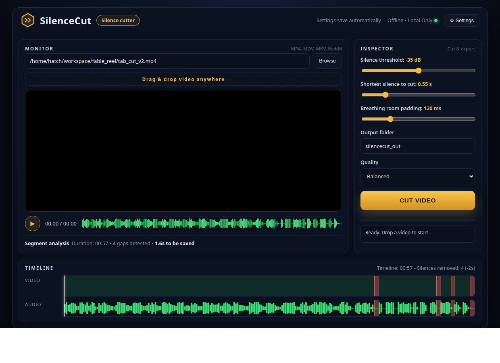

# SilenceCut

A free, offline silence cutter for talking videos. Drop in a video,
SilenceCut finds the silent gaps with ffmpeg and removes only those,
keeping your speech untouched. No uploads, no account, no API key,
everything runs on your own computer.



## Run it

Windows: double click `SilenceCut.bat`
Linux / macOS: `./silencecut.sh`

The editor opens in a desktop window (or your browser). You need
Python 3 and ffmpeg installed; both are free.

## The editor

A proper editor layout: Monitor in the centre, Inspector on the
right, and a two-track timeline along the bottom (Video, Audio).

- Drag and drop a video anywhere in the window, or browse, or paste
  a file path (MP4, MOV, MKV, WebM)
- The Monitor plays the video with a live waveform strip and a
  segment analysis line: duration, gaps detected, seconds to be saved
- The timeline paints speech green and silences red on both tracks,
  with a filmstrip on the Video track, a playhead that follows
  playback, and click-to-seek on every track
- After cutting, preview the finished video in the same Monitor
- Every setting saves itself automatically and is restored on the
  next launch

## Controls

- **Silence threshold** (dB): how quiet a part must be to count as
  silence. Lower catches more, higher is safer. Start at -35.
- **Shortest silence to cut** (seconds): gaps shorter than this are
  kept, so natural pauses survive. Start at 0.55.
- **Breathing room padding** (ms): a little space kept around every
  cut, so words never clip. Start at 120.
- **Quality**: Fast, Balanced or Best export.
- **Output folder**: where the finished video lands, named
  `yourvideo_cut.mp4`.

## Command line

```
python3 silencecut.py video.mp4                 # cut with defaults
python3 silencecut.py video.mp4 --thresh -40    # catch quieter gaps
python3 silencecut.py video.mp4 -o out.mp4 --quality fast
```

The code also contains a caption engine (Whisper transcription with
160 caption templates in 10 styles and 16 colour themes), usable from
the command line with `--template`, `--lang` and `--model`. It is not
part of the GUI in this release.

## How it works

1. ffmpeg `silencedetect` maps every silent gap in the audio.
2. Speech segments are kept with your padding added around each one.
3. The keeps are re-encoded into one clean video (H.264 + AAC).

## Tested

- Real 57.9 second talking video: 4 silences found, 57.9s cut to
  56.3s, exactly the known gaps, valid H.264 + AAC output.
- Editor job flow tested end to end through the app itself.
- Drag and drop upload, silence detection, video playback streaming
  and settings save/restore all verified.
- Changing videos repeatedly (A to B to A) verified in a real
  browser: duration, silence map, waveform and timeline always match
  the video on screen. Dropping the same file name twice keeps both
  copies. A browser cancelling a stream mid-play (normal when you
  switch videos) is handled quietly, with no errors.

## Files

- `silencecut.py` - the engine and command line
- `silencecut_web.py` - the editor window (local, 127.0.0.1 only)
- `transcribe.py` + `templates.json` - the caption engine (CLI use)
- `SilenceCut.bat` / `silencecut.sh` - launchers

## License

MIT
